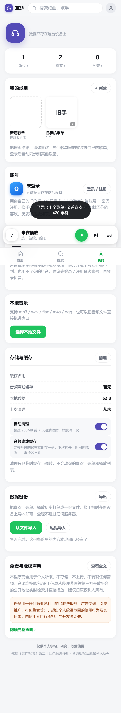

# 耳边 Erbian

> **天下苦会员久矣，AI 改变了听歌方式。**
> 搜歌 → 播放 → 歌词 → 收藏，一条龙，不登录会员、不看广告、数据全在自己手里。

耳边（Erbian）是一个**单文件 Node.js 音乐播放器**：一个 `listen-server.js` + 一个 `listen.html`，跑起来就是完整的应用。音源来自 B 站音乐区的公开音频轨，界面是为手机横竖屏都好用的暗色 UI。

| 播放页 | 歌词 | 曲库 |
|---|---|---|
|  |  |  |

## 为什么做它

音乐 App 的会员越买越多：这首要 VIP、那首要付费专辑、听歌识曲要会员、连歌词都要会员。而其实我们只是想**安静地听一首歌**。

B 站音乐区有海量高音质音轨（很多 320kbps），于是有了耳边：

- **零框架**：只用 Node.js 内置模块（外加一个接口签名依赖），`npm i` 不到 1 秒
- **单文件易改**：想加功能？`listen-server.js`（服务）和 `listen.html`（前端）就是全部
- **数据自主**：歌单、收藏、播放记录、歌词校准都在本地 JSON，随时导出导入，不经过任何第三方

## 功能

| 功能 | 说明 |
|---|---|
| 🎵 多音源 | B 站音乐区搜索播放；抖音音源（扫码登录后可用）；本地文件导入 |
| 📝 歌词 | 自动匹配 QQ 音乐/网易云歌词，支持翻译、点击跳转、手动校准（±0.1s）、对不上自动重查 |
| 💾 音频缓存 | 磁盘 LRU 缓存（400MB / 60 天），二次播放毫秒级出声 |
| ☁️ 数据同步 | 自选数字账号（如 QQ 号）注册登录，歌单/收藏跨设备同步，全存在你自己的服务器上 |
| 📦 备份 | 一键导出/导入 JSON 备份，合并式导入（幂等，不怕重复导） |
| 🔍 猜你喜欢 | 基于播放/收藏行为的本地推荐 |
| 🧹 空间管理 | 缓存超限自动清理，手机上也能一键清 |

## 30 秒跑起来

```bash
git clone https://github.com/A-Leaf-Fly/erbian.git
cd erbian
npm install
npm start
```

打开 `http://localhost:5599`（手机与电脑同一 Wi-Fi 时，用 `http://电脑IP:5599` 访问）。Windows 可直接双击 `start-listen.bat`。

要求：Node.js ≥ 18，无其他依赖。

## 手机版（APK）构建思路

`android/` 目录里是「本地版」安卓壳：把 Node 运行时（`libnode.so`）+ 服务端 + 前端**全部打进 APK**，启动后 WebView 只连 `127.0.0.1`——离线可跑，不依赖任何云端。

构建方式刻意**不使用 Gradle**，一个 bash 脚本走完 7 步（aapt2 → javac → d8 → 打包 → zipalign → 签名），约 1 分钟出 18MB 的 APK：

```bash
cd android
export KS_PASS=你的签名密码          # 首次运行会自动生成 erbian.jks
ANDROID_SDK=/path/to/sdk bash build-local.sh
```

需要自备：Android SDK（build-tools 34 + platform 34 + NDK r26）、JDK 17、[node-android](https://github.com/) 提供的 `libnode18-arm64.so`（构建脚本会自动拷入 `jniLibs/`，`.so` 与密钥均不入库）。

## 工作原理

```
┌─────────────┐   HTTP    ┌──────────────────┐   上游 API   ┌─────────┐
│  浏览器/APP  │ ────────→ │ listen-server.js │ ───────────→ │ B站/抖音 │
│ listen.html │ ←──────── │  纯 Node 内置模块  │ ←─────────── │ QQ/网易云│
└─────────────┘  音频流+API └──────────────────┘  搜索/歌词/音轨 └─────────┘
                                   │
                          .listen-data/（缓存与数据）
```

- **搜索**：B 站搜索限定音乐分区 + 时长过滤 + 标题黑名单，滤掉影视剪辑/解说，只留「能听的歌」
- **播放**：解析音轨直链后**边转发边落盘**，命中缓存直接 `Range` 流式回源，支持拖进度条
- **歌词**：标题+歌手+时长三重指纹打分选最佳匹配，纯音乐占位词自动跳过，偏移超阈值自动重新匹配
- **抖音音源**：本地起浏览器会话扫码登录，会话 Cookie 只存本机 `.dydata/`（已被 `.gitignore` 排除）

## 已知限制

- 音源来自平台公开接口，**可能随平台改版失效**（这正是单文件设计的意义：改起来快）
- 抖音音源需要扫码登录且会话会过期；B 站音源无需登录
- 安卓本地版目前只编了 `arm64-v8a`；Android 15 的 16KB 内存页设备需验证兼容性
- 歌词匹配依赖标题/歌手信息质量，翻唱/ REMIX 版本可能匹配到原曲

## 一次性演示

当在服务器根目录放一个 `demo-code.txt`（内容为任意口令）时，服务会自动启用**一次性演示门**：口令只能成功进入一位访客（进入后获得 24h cookie），适合"看一眼就走"的公开演示。不放该文件则功能完全不启用。

## 免责声明

本项目仅供学习交流，不存储、不分发任何音频文件；播放内容均来自第三方平台的公开接口，版权归原平台及权利人所有。请支持正版。使用本项目产生的任何问题与作者无关，请于下载后 24 小时内删除。

## License

[MIT](LICENSE)
